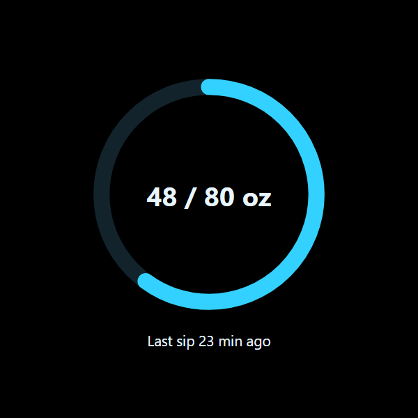
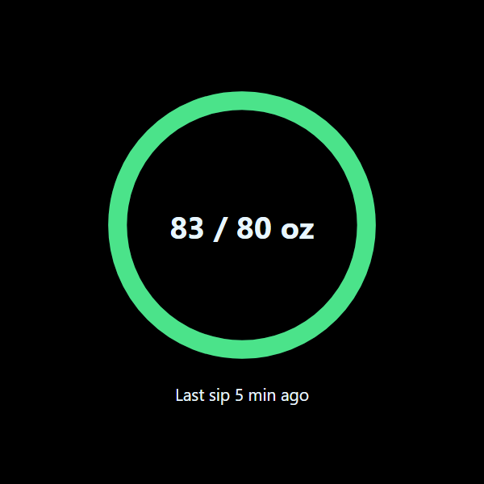
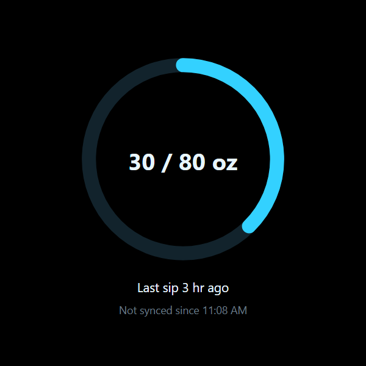

# HidrateLens

See today's water intake from your **HidrateSpark** smart bottle on **Meta Ray-Ban Display** glasses: a progress ring, your total vs. daily goal, and how long ago you last drank.

It's a personal, single-user project. Fork it and deploy your own copy.

```
HidrateSpark bottle ──BLE──> HidrateSpark iOS app ──> Apple Health (Dietary Water)
                                                          │
                              iOS Shortcut "Sync Hydration" (reads + sums today)
                                                          │  POST /api/intake (WRITE_TOKEN)
                                                          ▼
                                     Cloudflare Worker ──> KV (HIDRATELENS)
                                       │   serves static Web App + GET /api/today
                                       ▼  (READ_TOKEN)
                              Ray-Ban Display Web App (polls every 60 s)
```

## How it works

- HidrateSpark has no public API, but its iPhone app writes every sip to **Apple Health**.
- An **iOS Shortcut** sums today's water from Apple Health and sends it to a **Cloudflare Worker**.
- The Worker stores the latest reading in **Workers KV** and serves a small **Web App** that runs on the glasses.

## Prerequisites

- A Cloudflare account (the free plan is fine)
- Node.js 22+ (Wrangler 4 requires it)
- An iPhone with the HidrateSpark app syncing to Apple Health
- Meta Ray-Ban Display glasses with developer preview access (Web Apps)

## Deploy

```bash
npm install
npx wrangler login
npx wrangler kv namespace create HIDRATELENS
```

Paste the printed namespace `id` into `wrangler.jsonc`, replacing `REPLACE_WITH_YOUR_KV_ID`.

Generate two **different** random tokens:

```bash
node -e "console.log(crypto.randomUUID()+crypto.randomUUID())"
```

Store them as Worker secrets. Each command prompts for its value.

```bash
npx wrangler secret put WRITE_TOKEN
npx wrangler secret put READ_TOKEN
```

Then deploy:

```bash
npm run deploy
```

Wrangler prints your Worker URL, for example `https://hidratelens.<you>.workers.dev`.

## Set up the iPhone Shortcut

Follow [docs/shortcut-setup.md](docs/shortcut-setup.md). The Shortcut uses your **WRITE_TOKEN**.

## Open it on the glasses

Open this link once on the glasses' Web App:

```
https://<your-worker-url>/?key=<READ_TOKEN>
```

The app saves the key and removes it from the address bar. Add `&unit=ml` to show millilitres instead of ounces.

## What you'll see

| In progress | Goal met | Not synced lately |
| :---: | :---: | :---: |
|  |  |  |

Black pixels are transparent on the glasses' display, so only the ring and text appear over your view.

- **Ring:** today's total as a share of your goal. It turns green when you reach the goal.
- **`48 / 80 oz`:** today's total and your goal.
- **`Last sip 23 min ago`:** time since your newest drink. It shows `No water yet today` when there's nothing yet.
- **`Not synced since 2:10 PM`:** shown when the latest data is over 2 hours old.
- A grey dot in the corner means the glasses are offline. The last good reading stays on screen.

## Development

```bash
cp .dev.vars.example .dev.vars   # local tokens
npm run dev                      # http://localhost:8787/?key=<READ_TOKEN from .dev.vars>
npm test                         # Worker + display logic (Vitest in the Workers runtime)
npm run test:e2e                 # Playwright smoke test (run `npx playwright install chromium` once)
```

## Limitations

- **The phone must be unlocked to sync.** iOS blocks Shortcuts from reading Health data while the phone is locked. The Shortcut runs when you close the HidrateSpark app, plus a few timed backups.
- **Developer preview only.** Ray-Ban Display Web Apps can only be shared with testers in your own developer organization for now.
- **Your goal is typed into the Shortcut,** because HidrateSpark doesn't write it to Apple Health.

## License

[MIT](LICENSE)
